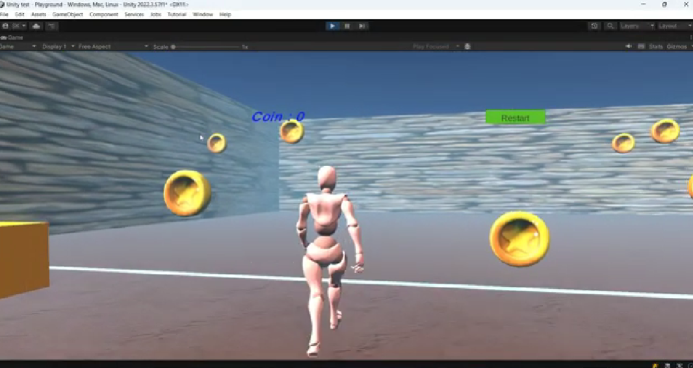

# Escape Game

**Unity Escape** is a 3D escape room game built with Unity. The player is locked in a mysterious room and must collect all the pieces and find clues to escape. 

---

## Features

- Coin collection
- Immersive sound design
- Physics interactions




## Getting Started

### 1. Clone the repository:
    ```bash
    git clone https://github.com/longa16/Escape_Game.git

### 2. Open the project in Unity:
- Open Unity Hub
- Click "Add" and select the cloned folder
- Open the project using the recommended Unity version

##  Built With
- Unity
- C# for game logic
- Assets from Unity Asset Store or custom-made

## Build Instructions
To export the game:

- Go to File > Build Settings
- Select your target platform (Windows, macOS, WebGL, etc.)
- Click Build
